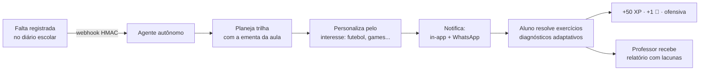
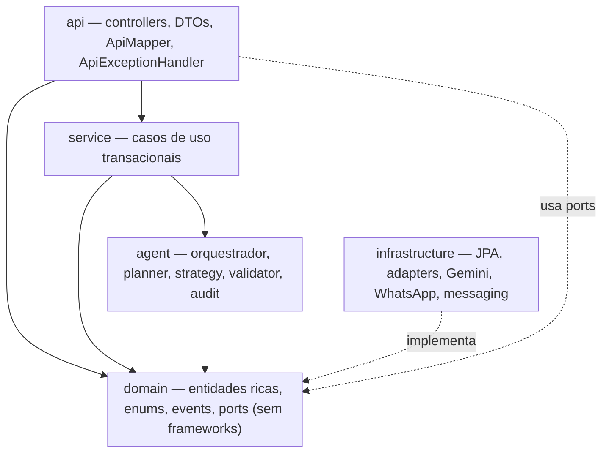

# 🎓 Educa Mais

**Agente autônomo de IA que detecta a falta escolar, ensina o que ficou para trás com os interesses do aluno e devolve o diagnóstico ao professor.**

> Hackathon AKCIT Camp · **ODS 4 — Educação de qualidade** · Java 21 + Spring Boot 4 · Angular 22 + VMware Clarity · AWS

[](VERSION)
[](https://github.com/MarkosFerreiraTech/educa-mais-ai/actions/workflows/backend-ci.yml)
[](https://github.com/MarkosFerreiraTech/educa-mais-ai/actions/workflows/frontend-ci.yml)
[](https://github.com/MarkosFerreiraTech/educa-mais-ai/actions/workflows/devsecops.yml)
[](backend/target/site/jacoco/index.html)
[](https://openjdk.org/projects/jdk/21/)
[](https://spring.io/projects/spring-boot)
[](https://angular.dev)
[](https://clarity.design)
[](LICENSE)

---

## 📖 O problema

Quando um estudante falta, o conteúdo perdido se acumula: **é difícil recuperar o que não se viu** e **o professor só percebe a lacuna semanas depois**, na prova. No Brasil, a evasão e a defasagem idade-série atingem justamente quem mais depende da escola pública — cada falta não tratada aumenta a chance de abandono.

O **Educa Mais** fecha esse ciclo em minutos, sem trabalho manual:



**O que torna a solução diferente:**

| Diferencial | Como funciona |
| --- | --- |
| 🤖 **Agente, não chatbot** | Detecta → planeja → notifica → avalia → adapta → reporta, com audit trail de cada decisão |
| 🧠 **Conteúdo ancorado na ementa** | `GroundedContentValidator` rejeita passos fora dos objetivos da aula (anti-alucinação) |
| 🪜 **Adaptação pedagógica real** | Erro escala a estratégia: `EXPLICIT → ANALOGY → VISUAL → STEP_BY_STEP`, com novas explicações geradas pelo Gemini |
| ⚽ **Interesses como contexto** | Cada explicação usa o universo do aluno (futebol, games, música...) — decisão pedagógica, não cosmética |
| 🛡️ **Degradação graciosa** | Sem chave do Gemini ou do WhatsApp, o ciclo **continua funcionando** com plano determinístico e provider `DEMO` |
| 🔒 **Privacidade desde o schema** | PII cifrada em AES-256-GCM, índice cego para busca por e-mail, consentimento do responsável |

---

## 🚀 Quick start

### Docker Compose (recomendado)

```bash
git clone https://github.com/MarkosFerreiraTech/educa-mais-ai.git
cd educa-mais-ai
cp .env.example .env          # opcional: preencha GEMINI_API_KEY / TWILIO_*
docker compose up -d --build

# API      → http://localhost:8080/actuator/health
# Web      → http://localhost:4200
# Authelia → docker compose --profile sso up -d   (http://localhost:9091)
```

O perfil `demo` já cria a escola, a turma, um aluno (`ana.souza@escola.br` / `Demo@2026`), a aula de frações e os itens da loja, permitindo rodar o ciclo completo sem cadastro.

### Rodando localmente

```bash
# Backend (Java 21 + Maven Wrapper)
#   dev  → H2 em memoria (nao precisa de Docker)
#   demo → Postgres (precisa do `docker compose up postgres`)
cd backend
SPRING_PROFILES_ACTIVE=dev  ./mvnw spring-boot:run       # http://localhost:8080 (H2)
SPRING_PROFILES_ACTIVE=demo ./mvnw spring-boot:run       # http://localhost:8080 (Postgres)

# Frontend (Node 22)
cd frontend
npm ci
npm start                                                # http://localhost:4200 (proxy /api → 8080)
```

Uma aula de demonstração e o webhook podem ser disparados com:

```bash
./scripts/demo-ciclo.sh      # registra falta assinada e mostra missão + notificações
```

### Se `docker compose up` falhar

A API precisa subir antes do web. Verifique nesta ordem:

```bash
docker compose ps                      # api deve aparecer como (healthy)
docker compose logs --tail=100 api     # stacktrace do Spring, se morreu no startup
```

| Sintoma | Causa provável | Correção |
| --- | --- | --- |
| `api exited (1)` + `Failed to determine a suitable driver class` | perfil `demo` herdando o driver H2 do `dev` | corrigido: `demo` declara `org.postgresql.Driver` |
| `api exited (1)` + `Schema-validation: missing table/column` | migration do Postgres divergente da entidade | rodar `docker compose down -v` para recriar o volume |
| `401`/`500` ao cadastrar aluno no app | `schoolId`/`classroomId` inexistentes (FK) | as migrations V2 já semeiam escola e turma de demo |
| login do aluno demo retorna `401` | hash `{noop}` no seeder | corrigido: seeder usa BCrypt real |

Para recomeçar do zero (apaga volumes, inclusive o banco):

```bash
docker compose down -v && docker compose up -d --build
```

---

## 🧩 Stack e arquitetura

| Camada | Tecnologias |
| --- | --- |
| **Backend** | Java 21, Spring Boot 4.0.9 (Web MVC, Security 7, Data JPA, Validation, Actuator), Hibernate 7, Flyway, PostgreSQL 16 |
| **Agente de IA** | Google Gemini Flash (`gemini-2.5-flash`) com *tool calling* + *structured outputs*, encapsulado pelo port `LlmPort` |
| **Frontend** | Angular 22 (standalone, zoneless, rotas lazy), VMware Clarity (`@clr/angular` 18.5, `@clr/ui`, `@cds/core`) + design system próprio ([docs/design-system.md](docs/design-system.md)), fonte Nunito self-hosted, Mobile-First |
| **Mensageria** | Domain Events (Observer) + listener transacional `AFTER_COMMIT`; em nuvem, EventBridge → SQS |
| **Cloud (AWS)** | App Runner (API), Amplify (SPA), RDS PostgreSQL, EventBridge/SQS, Secrets Manager/KMS, CloudWatch |
| **Qualidade** | JUnit 5, Mockito, AssertJ, ArchUnit (regras de camada), JaCoCo (gate 60% linhas), Checkstyle, SonarQube |
| **DevSecOps** | OWASP Dependency-Check, Gitleaks, Trivy, CodeQL, Dependabot |

### Hexagonal + camadas (SOLID na prática)



Regras verificadas por **ArchUnit** (falham o build):
`domain` não depende de Spring/JPA · `service` não depende de controllers · controllers não acessam repositórios JPA ·
todo adapter implementa um port · dependências apontam para dentro.

**Padrões aplicados:** Adapter (ports & adapters), Strategy (estratégias pedagógicas), Observer (eventos de domínio),
State (máquina de estados da missão), Repository, Facade (`MissionRecoveryFacade`), Factory (`DiagnosticQuestionFactory`),
Builder (payload do Gemini), DTO × Entity (nunca expostos), Dependency Injection em 100% das dependências.

---

## ✅ Funcionalidades

### Implementado no MVP

| Área | Recurso | Requisitos |
| --- | --- | --- |
| 🔔 Detecção | Webhook do sistema escolar com HMAC-SHA256, API Key, tolerância a replay e idempotência por `eventId` | RF06-RF10 |
| 🤖 Agente | Planejamento de 2-5 passos com Gemini Flash; **grounding** na ementa; fallback determinístico; audit trail | RF12-RF15, RF21 |
| 🎯 Adaptação | Escada `EXPLICIT→ANALOGY→VISUAL→STEP_BY_STEP`, máx. 3 tentativas por passo, apoio do professor na 3ª | RF17-RF19, RN05 |
| 📲 Notificação | In-app + WhatsApp (Twilio Sandbox, Evolution API ou provider `DEMO`), respeitando opt-in | RF22-RF26 |
| 🎮 Gamificação | +50 XP e +1 💎 por missão (idempotente), ofensiva de dias, nível, loja e conversão 1 💎 = 10 moedas | RF29-RF32, RN01-RN04 |
| 👩‍🏫 Professor | Relatório automático (resumo, taxa de acerto, lacunas, recomendação) + dashboard da turma | RF33-RF35 |
| 🔐 Segurança | JWT stateless (access/refresh), RBAC, CORS por allowlist, rate limit, bcrypt 12, AES-256-GCM, LGPD (anonimização) | RF01-RF05, RNF06-RNF11 |
| 🖥️ Frontend | Login, onboarding de interesses, jornada da missão, loja, perfil e dashboard do professor (Clarity + design system lúdico, Mobile-First, WCAG 2.2 AA) | RF38-RF40 |
| ☁️ Infra | Docker Compose completo, Dockerfiles multi-stage, Authelia/OIDC, Prometheus/Grafana, health checks | RNF12-RNF16 |

### Planejado (pós-hackathon)

- Aplicativo mobile nativo (React Native) e notificações push
- Integração com mais ERPs escolares (i-Educar, Sponte) via conectores plugáveis
- Moderação de conteúdo gerado por IA por revisão humana antes da entrega
- Ranking entre turmas e eventos sazonais de gamificação
- Painel público de indicadores por escola (ODS 4)

---

## 🗂️ Estrutura do repositório

```
educa-mais-ai/
├── backend/                    # API Spring Boot 4 (Java 21)
│   ├── src/main/java/br/com/educamais/
│   │   ├── domain/             # entidades ricas, enums, eventos, ports (zero framework)
│   │   ├── agent/              # orquestrador, planner, strategy, validator, audit
│   │   ├── service/            # casos de uso transacionais
│   │   ├── api/                # controllers, DTOs, mapper, tratamento de erro
│   │   ├── infrastructure/     # JPA, adapters Gemini/WhatsApp, messaging
│   │   ├── security/           # JWT, HMAC, rate limit, SecurityConfig
│   │   └── config/             # properties, beans, async
│   ├── src/main/resources/db/
│   │   ├── migration/          # Flyway - PostgreSQL (perfil demo/prod)
│   │   └── migration-h2/       # Flyway - H2 (perfis dev/test)
│   └── src/test/java/          # unitários, ArchUnit e ITs de fluxo
├── frontend/                   # SPA Angular 22 + Clarity
├── docs/                       # charter, requisitos, casos de uso, user stories, arquitetura
│   ├── adr/                    # decisões arquiteturais (ADR-001..006)
│   ├── api/openapi.yaml        # contrato REST (18 rotas)
│   └── diagramas/              # índice dos diagramas Mermaid
├── infra/                      # Authelia (OIDC) e observabilidade
├── scripts/                    # setup-gitflow, ci-doctor, demo-ciclo
├── .github/workflows/          # Backend CI, Frontend CI, DevSecOps, CodeQL
└── docker-compose.yml
```

---

## 🔧 Variáveis de ambiente

| Variável | Obrigatória | Descrição |
| --- | --- | --- |
| `DB_URL` / `DB_USER` / `DB_PASSWORD` | ✅ prod | Conexão PostgreSQL (`jdbc:postgresql://host:5432/educamais`) |
| `JWT_SECRET` | ✅ prod | ≥ 32 caracteres; assina access/refresh tokens |
| `ENCRYPTION_KEY` | ✅ prod | Chave AES-256 (base64/hex) para PII; em prod vem do Secrets Manager/KMS |
| `SCHOOL_API_KEY` / `SCHOOL_HMAC_SECRET` | ✅ prod | Credenciais do webhook escolar |
| `CORS_ALLOWED_ORIGINS` | ✅ prod | Allowlist separada por vírgula (nunca `*`) |
| `GEMINI_ENABLED` / `GEMINI_API_KEY` / `GEMINI_MODEL` | ❌ | Sem chave, o agente usa plano determinístico (`FALLBACK`) |
| `WHATSAPP_PROVIDER` | ❌ | `DEMO` (padrão), `TWILIO` ou `EVOLUTION` |
| `TWILIO_ACCOUNT_SID` / `TWILIO_AUTH_TOKEN` / `TWILIO_WHATSAPP_FROM` | ❌ | Credenciais do Twilio Sandbox |
| `EVOLUTION_API_URL` / `EVOLUTION_API_KEY` / `EVOLUTION_INSTANCE` | ❌ | Alternativa self-hosted ao Twilio |
| `AUTHELIA_ENABLED` / `AUTHELIA_ISSUER_URI` / `AUTHELIA_CLIENT_ID` / `AUTHELIA_CLIENT_SECRET` | ❌ | SSO OIDC de professores/administradores |
| `AGENT_MAX_STEPS` / `AGENT_MAX_ATTEMPTS_STEP` | ❌ | Limites do plano (padrão 5 e 3) |
| `SPRING_PROFILES_ACTIVE` | ❌ | `dev`, `demo`, `test`, `prod` |

> ⚠️ **Nunca** comite segredos. Use `.env` (ignorado pelo Git), Secrets Manager na AWS e os *secrets* do GitHub Actions.

### Integrações opcionais

**Gemini** — obtenha uma chave no [Google AI Studio](https://aistudio.google.com/apikey) e defina
`GEMINI_ENABLED=true` + `GEMINI_API_KEY`. O modelo recebe *function declarations* (ementa, perfil do aluno, limite de passos)
e responde em JSON estruturado; se a resposta violar o grounding, o `RecoveryPlanner` cai no plano determinístico.

**WhatsApp** — com Twilio Sandbox: `WHATSAPP_PROVIDER=TWILIO` e as três variáveis `TWILIO_*`.
Com Evolution API: `WHATSAPP_PROVIDER=EVOLUTION` + `EVOLUTION_API_URL/KEY/INSTANCE`.
Sem credenciais, o provider `DEMO` registra a notificação como `SKIPPED` (o histórico in-app continua completo).

**Authelia (OIDC/SSO)** — `docker compose --profile sso up -d` e depois
`AUTHELIA_ENABLED=true` na API. Usuários de exemplo: `professor.demo` (grupo `professores`) e
`gestor.demo` (grupo `administradores`), ambos com senha `Educa@2026` no arquivo de desenvolvimento.

---

## 📚 Documentação

| Documento | Conteúdo |
| --- | --- |
| [Project Charter](docs/project-charter.md) | Justificativa ODS 4, objetivos SMART, escopo in/out, stakeholders, riscos, KPIs |
| [Requisitos](docs/requisitos.md) | RF01-RF40 e RNF01-RNF24 com critérios de verificação e rastreabilidade |
| [Casos de uso](docs/casos-de-uso.md) | 11 casos de uso com atores, fluxo principal, alternativos e de exceção |
| [User stories](docs/user-stories.md) | Épicos e histórias em Gherkin com critérios de aceite |
| [Arquitetura do agente](docs/arquitetura-agente.md) | C4 (contexto/containers/componentes), fluxo autônomo, DER, AWS, segurança, padrões |
| [Changelog](CHANGELOG.md) | Releases v0.1.0 → v1.0.0, com o que entrou em cada marco |
| [Rastreabilidade](docs/rastreabilidade.md) | Matriz requisito → caso de uso → issue → código → teste (e o inverso) |
| [Diagramas](docs/diagramas/README.md) | Índice dos diagramas Mermaid por visão arquitetural |
| [API (OpenAPI)](docs/api/openapi.yaml) | Contrato REST: 18 rotas, 14 schemas, erros padronizados |
| [ADRs](docs/adr/) | Decisões: hexagonal, Spring Boot 4, Gemini, WhatsApp híbrido, gamificação, observabilidade |

---

## 🧪 Qualidade e testes

```bash
make api-test      # JUnit 5 + Mockito + ArchUnit + ITs (Failsafe) + JaCoCo
make api-lint      # Checkstyle + SpotBugs
make web-test      # vitest (Angular)
make verify        # pipeline completo local
make ci-doctor     # diagnóstico da última execução do CI
```

| Suíte | O que cobre |
| --- | --- |
| **Domínio** | Máquina de estados da missão, escada pedagógica, gamificação (XP/💎/moedas/streak), interesses, ementa |
| **Agente** | `RecoveryPlanner` (LLM, plano parcial, fallback), `GroundedContentValidator`, estratégias, `AdaptiveStrategySelector` |
| **Serviços** | `AssessmentService`, `AttendanceService`, `NotificationService`, `RewardService`, `ShopService`, `TeacherReportService`, `PrivacyService`, `MissionService`, `StudentService`, `MissionRecoveryFacade` |
| **Segurança** | `JwtService`, `JwtAuthenticationFilter` (401/403), `HmacSignatureValidator` (replay), `LoginAttemptGuard`, CORS |
| **Arquitetura** | ArchUnit: dependências entre camadas e ports/adapter |
| **Integração (IT)** | `AuthFlowIT`, `StudentAreaIT`, `AutonomousCycleIT` — cadastro → webhook → missão → adaptação → recompensa → relatório |
| **Frontend** | `AuthService` (tokens, expiração, mensagens de erro) |

Cobertura atual: **73,6% de linhas / 72,0% de instruções** (gate mínimo: 60% de linhas), com gate de
estilo (Checkstyle) e de arquitetura (ArchUnit) bloqueando o merge.

---

## 🌱 Fluxo GitFlow e versionamento


| Branch | Papel | Origem → destino |
| --- | --- | --- |
| `main` | Código em produção, sempre verde, cada merge recebe tag anotada | `release/*` · `hotfix/*` |
| `develop` | Integração contínua das funcionalidades | `feature/*` |
| `feature/#<issue>-<slug>` | Uma issue = uma branch = um PR | `develop` |
| `release/<versao>` | Estabilização, correções de última hora, version bump | `develop` → `main` + `develop` |
| `hotfix/<versao>` | Correção urgente em produção | `main` → `main` + `develop` |

**Conventional Commits** com escopo: `feat(agent):`, `fix(persistence):`, `test(it):`, `docs(api):`, `ci(backend):`, `refactor(domain):`.
O script [`scripts/setup-gitflow.sh`](scripts/setup-gitflow.sh) recria branches, tags anotadas (`v0.1.0`, `v0.2.0`, `v1.0.0`) e o push inicial.

### Versionamento SemVer

| Versão | Marco |
| --- | --- |
| `v0.1.0` | Fundação: domínio hexagonal, segurança JWT/HMAC, documentação e CI |
| `v0.2.0` | Agente autônomo: Gemini + planner, adaptação pedagógica, notificações |
| `v1.0.0` | MVP do hackathon: ciclo completo, gamificação, frontend Clarity, DevSecOps |

---

## 🔐 Segurança e LGPD

- **JWT stateless**: access token curto + refresh token; autorização por papel (`ALUNO`, `PROFESSOR`, `ADMIN`) e por dono do recurso.
- **Webhook**: `X-Api-Key` + HMAC-SHA256 do payload canônico + timestamp com tolerância de 5 min (anti-replay) + idempotência.
- **Dados pessoais**: nome, e-mail, telefone e data de nascimento cifrados com **AES-256-GCM**; busca por e-mail via **índice cego** (HMAC).
- **Direitos do titular**: anonimização (`/students/me` → `anonymize`) preservando estatísticas agregadas.
- **Cabeçalhos**: HSTS, `X-Content-Type-Options`, `Referrer-Policy: no-referrer`, CSP restritiva, `frame-ancestors 'none'`.
- **Auditoria**: `agent_audit_log` (decisão do agente) e `security_audit_log` (eventos sensíveis, sem PII).
- **Rate limiting**: 60 req/min por IP, 10/min no login, bloqueio após 10 falhas em 5 min.

Encontrou uma vulnerabilidade? Veja [`SECURITY.md`](SECURITY.md) — não abra issue pública.

---

## 🤝 Contribuindo

1. Abra/assuma uma issue com critérios de aceite (template `feature.yml`).
2. Crie a branch a partir de `develop`: `feature/#<issue>-<slug>`.
3. Commits atômicos em Conventional Commits, com testes.
4. `make verify` local antes do PR; o PR deve citar `Closes #<issue>`.
5. Merge via squash apenas com **CI verde** (backend, frontend, DevSecOps) e Quality Gate aprovado.

---

## 📄 Licença

Distribuído sob a licença **MIT** — veja [LICENSE](LICENSE).

<p align="center">
  Feito com 💙 para reduzir a defasagem escolar no Brasil · <strong>ODS 4 — Educação de qualidade</strong>
</p>
