# 🏛️ Arquitetura do Educa Mais

| Campo | Valor |
| --- | --- |
| Versão | 1.0.0 |
| Notação | C4 Model (Contexto, Contêiner, Componente) + DER + Fluxo do Agente |
| Stack | Java 21 · Spring Boot 4.0 · PostgreSQL 16 · Angular 22 · VMware Clarity 18 · AWS |
| Decisões | registradas em [`docs/adr/`](adr/) |

> Todos os diagramas estão em **Mermaid** e renderizam nativamente no GitHub.

---

## 1. Princípios Arquiteturais

| # | Princípio | Aplicação concreta |
| --- | --- | --- |
| P1 | **Domínio no centro (Hexagonal / Ports & Adapters)** | `domain` não conhece Spring, JPA nem HTTP. Interfaces `LlmPort`, `WhatsAppPort`, `ClockPort` |
| P2 | **SOLID** | Cada classe com responsabilidade única; Strategy para pedagogia; Adapter para integrações |
| P3 | **DIP** | Serviços dependem de abstrações (`NotificationPort`), nunca de `TwilioClient` |
| P4 | **DI** | Injeção por construtor em 100% dos componentes; zero `@Autowired` em campo |
| P5 | **DTO × Entity** | `api/dto` ↔ `domain/model` ↔ `infrastructure/persistence/entity`, com mappers explícitos |
| P6 | **Eventos de domínio** | `AttendanceRegisteredEvent` → `ApplicationEventPublisher` (Observer) |
| P7 | **Idempotência** | `eventId`, `missionId` como chaves naturais; operações repetíveis |
| P8 | **Fail-safe do agente** | Toda chamada a LLM tem timeout, retry, circuit breaker e fallback determinístico |

---

## 2. C4 — Nível 1: Contexto do Sistema

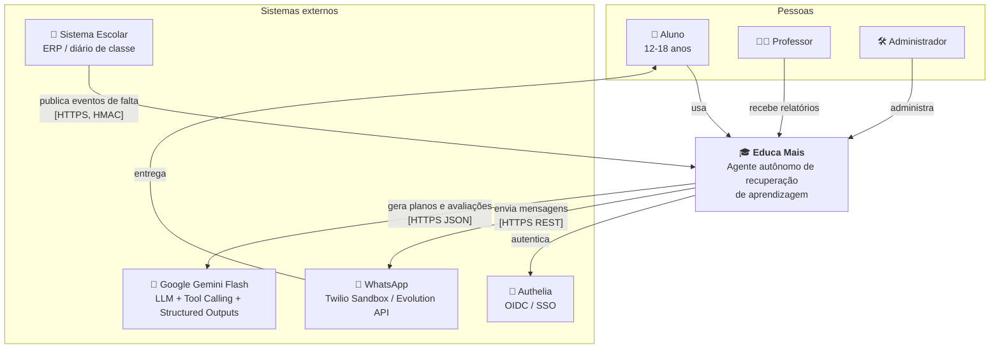

---

## 3. C4 — Nível 2: Contêineres

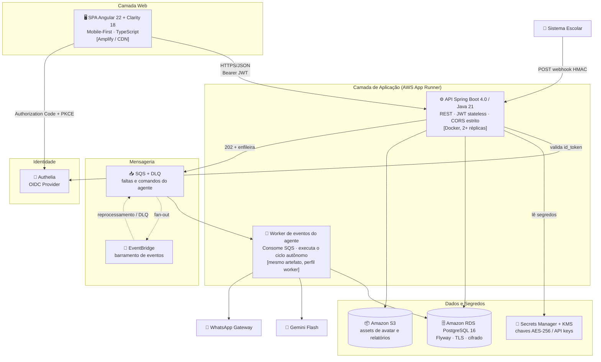

### Responsabilidades dos contêineres

| Contêiner | Responsabilidade | Tecnologia |
| --- | --- | --- |
| **SPA** | Experiência do aluno (missão, avatar, ofensiva) e do professor (dashboard) | Angular 22, Clarity 18, RxJS |
| **API** | Expor REST, autenticar, validar webhook, orquestrar comandos | Spring Boot 4, Spring Security 7, Flyway |
| **Worker** | Executar o ciclo autônomo do agente (planejar, notificar, avaliar, reportar) | Spring Boot 4 + SQS listener |
| **RDS** | Persistência transacional | PostgreSQL 16 |
| **SQS/DLQ** | Desacoplamento e resiliência da ingestão | AWS SQS |
| **Secrets Manager/KMS** | Chaves de cifragem e credenciais de providers | AWS |
| **Authelia** | SSO/OIDC para professores e administradores | Authelia 4.x |

---

## 4. C4 — Nível 3: Componentes do Backend

```mermaid
flowchart TB
    subgraph APRESENTACAO["1. Apresentação (Controllers)"]
        C1["AuthController"]
        C2["StudentController"]
        C3["MissionController"]
        C4["SchoolIntegrationController"]
        C5["TeacherController"]
        C6["ShopController"]
        C7["AdminController"]
    end

    subgraph SEGURANCA["6. Segurança"]
        S1["SecurityConfig<br/>CORS · headers · CSRF off (stateless)"]
        S2["JwtAuthenticationFilter"]
        S3["JwtService (emitir/validar)"]
        S4["HmacSignatureValidator"]
        S5["AccessPolicy (RBAC + vínculo)"]
        S6["RateLimitFilter"]
    end

    subgraph SERVICOS["2. Regra de Negócio (Services)"]
        SV1["StudentService"]
        SV2["AttendanceService"]
        SV3["MissionService"]
        SV4["AssessmentService"]
        SV5["RewardService / StreakService"]
        SV6["TeacherReportService"]
        SV7["ShopService"]
        SV8["NotificationService"]
    end

    subgraph AGENTE["3. Orquestração do Agente"]
        AG1["AttendanceIngestionListener<br/>(Observer)"]
        AG2["RecoveryPlanner"]
        AG3["MissionOrchestrator<br/>(máquina de estados)"]
        AG4["AdaptiveStrategySelector<br/>(Strategy)"]
        AG5["GroundedContentValidator"]
        AG6["AgentAuditTrail"]
        AG7["FallbackPlanner"]
    end

    subgraph DOMINIO["4. Modelo de Domínio"]
        D1["Student · Interest · Avatar"]
        D2["Attendance · Lesson · Syllabus"]
        D3["LearningRecoveryMission · MissionStep"]
        D4["DiagnosticQuestion · DiagnosticAttempt"]
        D5["GamificationProfile · Streak · Reward"]
        D6["TeacherReport · Notification"]
    end

    subgraph PORTS["Ports (interfaces)"]
        P1["LlmPort"]
        P2["NotificationPort"]
        P3["MessagingPort"]
        P4["SyllabusPort"]
        P5["ClockPort"]
        P6["EncryptionPort"]
    end

    subgraph ADAPTERS["5. Acesso a Dados e Adapters"]
        R1["JPA Repositories + Entities"]
        R2["GeminiAgentAdapter"]
        R3["WhatsAppNotificationAdapter<br/>(Twilio / Evolution / Demo)"]
        R4["InAppNotificationAdapter"]
        R5["EventBridgePublisher / SqsConsumer"]
        R6["AesGcmEncryptor"]
    end

    C1 --> SV1
    C2 --> SV1
    C3 --> SV3
    C4 --> SV2
    C5 --> SV6
    C6 --> SV7
    C7 --> SV1
    C3 --> S5
    S1 --> S2 --> S3
    C4 --> S4
    S1 --> S6

    SV2 --> AG1
    SV3 --> AG3
    AG1 --> AG2
    AG3 --> AG2
    AG3 --> AG4
    AG3 --> AG5
    AG3 --> AG6
    AG2 --> P1
    AG2 --> P4
    AG3 --> P2
    AG4 --> P1
    SV8 --> P2
    SV2 --> P3

    P1 -.-> R2
    P2 -.-> R3
    P2 -.-> R4
    P3 -.-> R5
    P4 -.-> R1
    P6 -.-> R6

    SV1 --> D1
    SV2 --> D2
    SV3 --> D3
    SV4 --> D4
    SV5 --> D5
    SV6 --> D6

    SV1 --> R1
    SV3 --> R1
    SV4 --> R1
    SV5 --> R1
    SV6 --> R1
    SV7 --> R1
    SV8 --> R1
```

### 4.1 Mapa de pacotes (implementado)

```text
br.com.educamais
├── EducaMaisApplication.java
├── api/                      # Camada de apresentação
│   ├── controller/           # REST controllers (thin)
│   ├── dto/                  # Records de request/response
│   ├── mapper/               # DTO <-> Domain
│   └── exception/            # @RestControllerAdvice + ApiError
├── config/                   # Configurações (OpenAPI, Jackson, Async, Resilience)
├── domain/
│   ├── model/                # Entidades de domínio puras (sem JPA)
│   ├── enums/
│   ├── event/                # Eventos de domínio (Observer)
│   ├── exception/            # Exceções de negócio
│   └── port/                 # Interfaces (DIP)
├── service/                  # Regras de negócio
├── agent/                    # Orquestração do agente autônomo
│   ├── planner/              # RecoveryPlanner + FallbackPlanner
│   ├── strategy/             # PedagogicalStrategy (Strategy pattern)
│   ├── validation/           # GroundedContentValidator
│   └── audit/                # AgentAuditTrail
├── security/                 # JWT, HMAC, CORS, RBAC, rate limit
├── crypto/                   # AES-256-GCM
└── infrastructure/
    ├── persistence/          # JPA entities, repositories, adapters
    ├── llm/                  # GeminiAgentAdapter + prompt factory
    ├── notification/         # WhatsApp / in-app adapters
    └── messaging/            # SQS / in-memory publisher
```

### 4.2 Regra de dependência (verificada por ArchUnit)

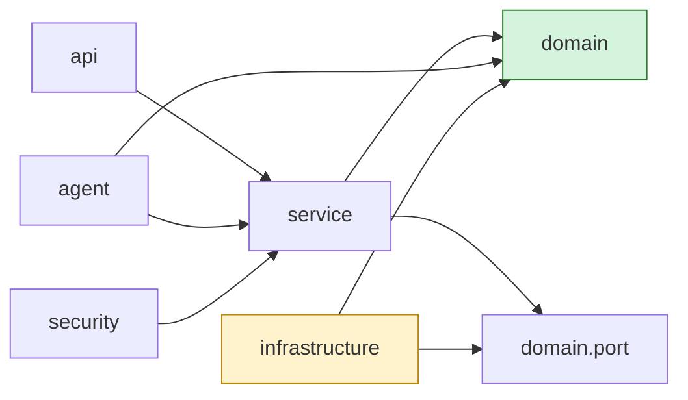

> **Regras:** `domain` não depende de ninguém; `infrastructure` nunca é importado por `domain` ou `service`;
> `api` não acessa repositórios diretamente. Violações quebram o build (`ArchitectureTest`).

---

## 5. Fluxo Autônomo do Agente (ponta a ponta)

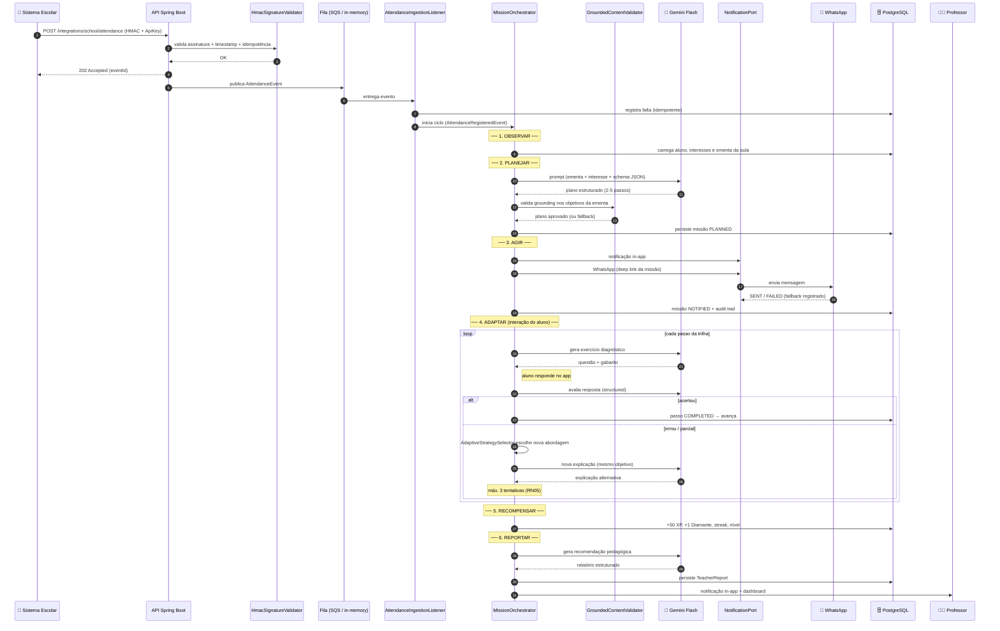

### 5.1 Máquina de estados da missão

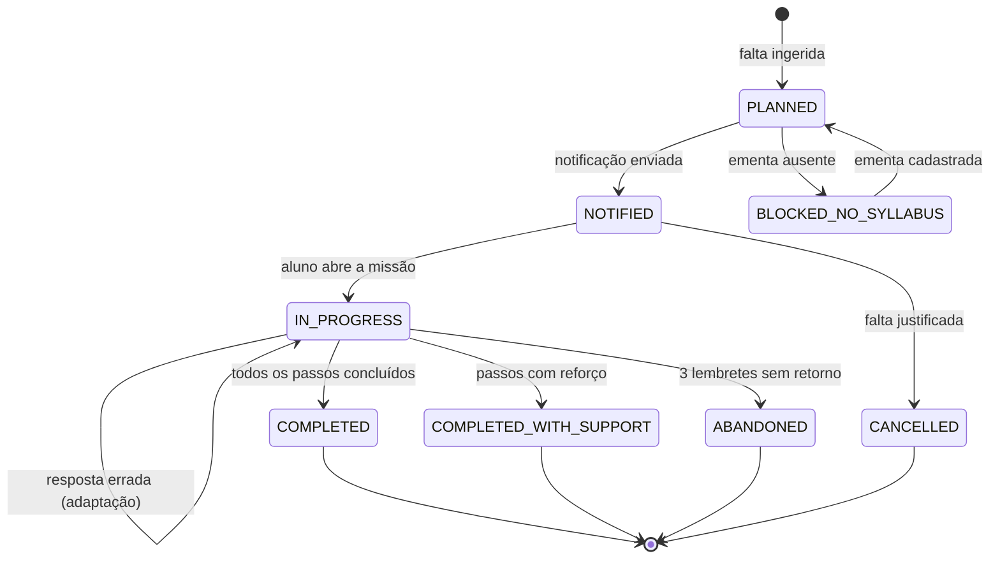

### 5.2 Estratégias pedagógicas (padrão Strategy)

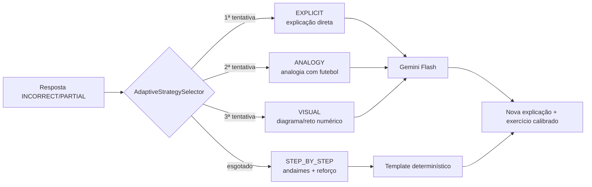

| Estratégia | Quando usar | Exemplo (frações, aluno fã de futebol) |
| --- | --- | --- |
| `EXPLICIT` | Primeira exposição ao conceito | "Fração é parte de um todo…" |
| `ANALOGY` | Aluno não engajou ou errou por abstração | "Em 4 chutes, 1 gol = 1/4 de aproveitamento" |
| `VISUAL` | Aluno precisa de representação concreta | Reta numérica dividida marcando 1/4 e 2/4 |
| `STEP_BY_STEP` | Erro persistente | Decomposição em 4 micro-passos com verificação |

---

## 6. Arquitetura AWS (produção)

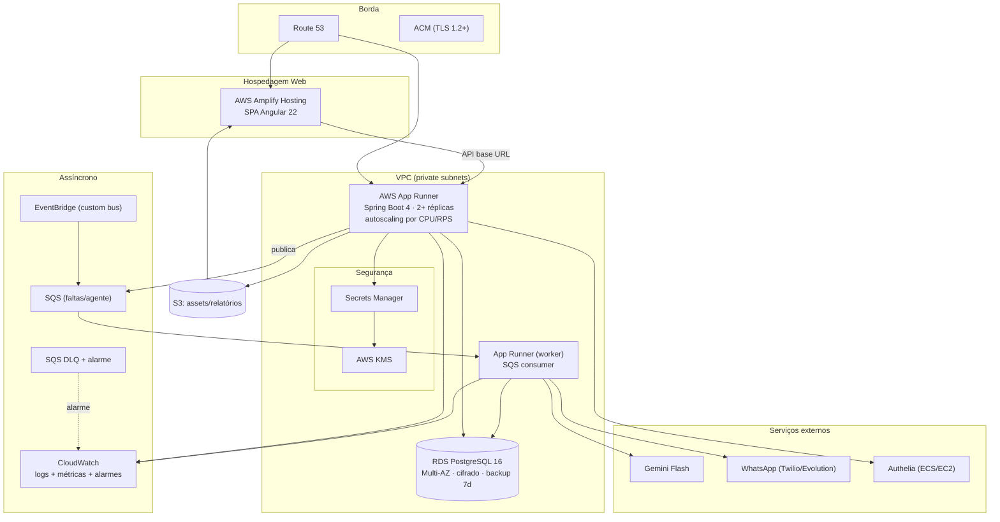

### 6.1 Mapeamento requisito → serviço AWS

| Necessidade | Serviço | Configuração |
| --- | --- | --- |
| Backend conteinerizado | **App Runner** | 1 vCPU/2 GB, health `/actuator/health`, 2 instâncias mín. |
| Banco relacional | **RDS PostgreSQL 16** | `db.t4g.micro`, cifrado, multi-AZ em prod |
| Frontend SPA | **Amplify Hosting** | Build Angular, HTTPS, cache CDN |
| Ingestão de faltas | **EventBridge + SQS** | bus custom + fila + DLQ |
| Segredos | **Secrets Manager** | rotação de chaves, IAM restrito |
| Cifragem de PII | **KMS** | CMK por ambiente, envelope encryption |
| Observabilidade | **CloudWatch** | logs JSON, métricas EMF, alarmes |
| Assets | **S3** | bucket privado + URL assinada |
| CI/CD | **GitHub Actions + OIDC** | sem *long-lived keys* (role assumida) |

### 6.2 Estratégia de ambientes

| Ambiente | Banco | LLM | WhatsApp | Custo aprox. |
| --- | --- | --- | --- | --- |
| `local` | Postgres Docker | mock/fallback | demo | R$ 0 |
| `dev` | RDS micro | Gemini real | Twilio Sandbox | ~US$ 20/mês |
| `prod` | RDS Multi-AZ | Gemini real | Twilio/Evolution | ~US$ 45/mês |

---

## 7. Segurança: Authelia (OIDC) + JWT + HMAC

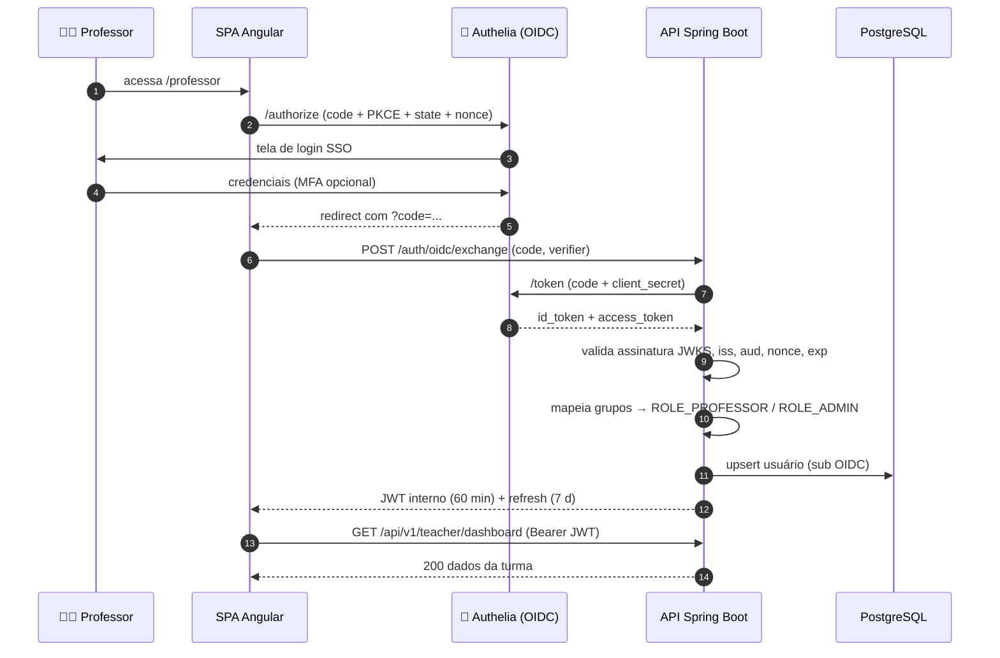

### 7.1 Camadas de defesa

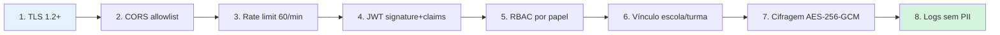

| Vetor de ataque | Controle | Requisito |
| --- | --- | --- |
| Token forjado | Assinatura HMAC/RSA + validação de claims | RNF06 |
| Replay de webhook | Timestamp 5 min + HMAC + idempotência | RF08, RF09 |
| CSRF | API stateless sem cookies de sessão | RNF06 |
| XSS | CSP estrita, escape padrão do Angular | RNF11 |
| Força bruta | Rate limit + bloqueio progressivo | RNF14 |
| Vazamento de PII em log | `PiiMasker` + revisão por teste | RF39 |
| Acesso horizontal | `AccessPolicy` por vínculo | RNF16 |
| Segredo no repo | Gitleaks no CI + `.gitignore` | RNF15 |
| Dependência vulnerável | OWASP Dependency-Check + Trivy | RNF15 |

---

## 8. Modelo Entidade-Relacionamento (DER)

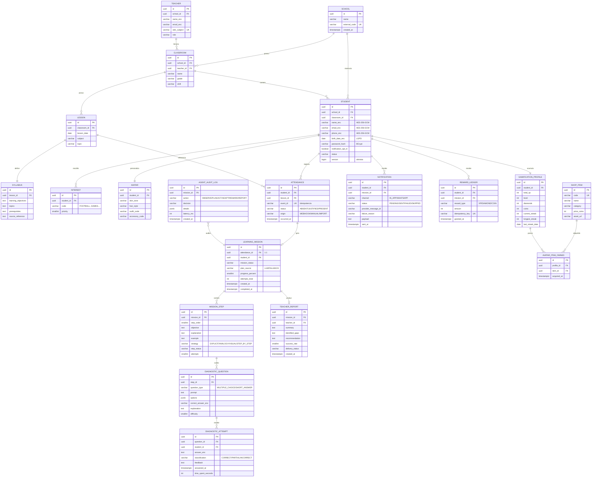

### 8.1 Índices e restrições críticas

| Tabela | Índice / Constraint | Justificativa |
| --- | --- | --- |
| `attendance` | `UNIQUE(event_id)` | Idempotência de webhook (RF09) |
| `attendance` | `INDEX(student_id, occurred_at DESC)` | Cálculo de streak e histórico |
| `learning_mission` | `UNIQUE(attendance_id)` | 1 falta → 1 missão (RN06) |
| `learning_mission` | `INDEX(student_id, mission_status)` | Listagem de missões do aluno |
| `diagnostic_attempt` | `INDEX(question_id, student_id)` | Histórico de adaptação |
| `reward_ledger` | `UNIQUE(idempotency_key)` | Recompensa única por missão (RN03) |
| `notification` | `INDEX(status, channel)` | Reprocessamento de falhas |
| `agent_audit_log` | `INDEX(mission_id, created_at)` | Rastreabilidade do ciclo autônomo |

---

## 9. Padrões de Projeto Aplicados

| Padrão | Onde | Problema resolvido | Arquivo de referência |
| --- | --- | --- | --- |
| **Strategy** | `PedagogicalStrategy` (`Explicit`, `Analogy`, `Visual`, `StepByStep`) | Trocar abordagem pedagógica sem `if/else` crescente | `agent/strategy/` |
| **Adapter** | `LlmPort` → `GeminiAgentAdapter`; `NotificationPort` → Twilio/Evolution/Demo | Isolar SDK externo do domínio | `infrastructure/llm`, `infrastructure/notification` |
| **Observer** | `AttendanceRegisteredEvent` → `MissionOrchestrator`, `AuditListener` | Reagir à falta sem acoplamento | `domain/event`, `agent/` |
| **Template Method** | `RecoveryPlanner` (esqueleto) × `FallbackPlanner` | Reaproveitar o fluxo de planejamento | `agent/planner/` |
| **Repository** | `StudentRepository` (port) × JPA | Persistência plugável | `domain/port`, `infrastructure/persistence` |
| **Factory** | `DiagnosticQuestionFactory`, `PromptFactory` | Centralizar construção complexa | `agent/`, `service/` |
| **State (light)** | `MissionStatus` com transições válidas | Impedir transições ilegais | `domain/model/MissionStatus` |
| **Decorator** | `RetryingLlmAdapter` envolvendo o adapter Gemini | Retry + circuit breaker sem duplicação | `infrastructure/llm/` |
| **DTO/Mapper** | `api/dto` + `api/mapper` | Não vazar entidade JPA na API | `api/` |

---

## 10. Observabilidade e Resiliência

| Aspecto | Implementação |
| --- | --- |
| **Logs** | JSON estruturado (`logstash-encoder`), `traceId` via `MDC`, PII mascarada |
| **Métricas** | Micrometer: `attendance_to_notification_seconds`, `agent_plan_duration_seconds`, `llm_fallback_total`, `whatsapp_failure_total` |
| **Tracing** | Propagação de `traceId` do webhook até o worker (header + MDC) |
| **Health** | `/actuator/health` com *liveness* e *readiness* (App Runner) |
| **Resiliência** | Resilience4j: timeout 20 s, retry 2×, circuit breaker (50% falhas / 10 chamadas) |
| **Idempotência** | Chaves naturais + *unique constraints* |
| **DLQ** | Fila morta com alarme CloudWatch e endpoint admin de *replay* |

---

## 11. ADRs (Architecture Decision Records)

| ADR | Título | Status |
| --- | --- | --- |
| [ADR-001](adr/ADR-001-spring-boot-4-java-21.md) | Spring Boot 4 sobre Java 21 | ✅ Aceito |
| [ADR-002](adr/ADR-002-gemini-flash-como-llm.md) | Gemini Flash com Structured Outputs e fallback | ✅ Aceito |
| [ADR-003](adr/ADR-003-arquitetura-hexagonal.md) | Arquitetura hexagonal (ports & adapters) | ✅ Aceito |
| [ADR-004](adr/ADR-004-jwt-stateless-authelia.md) | JWT stateless + Authelia (OIDC) | ✅ Aceito |
| [ADR-005](adr/ADR-005-cifragem-aes-256-gcm.md) | Cifragem de PII com AES-256-GCM | ✅ Aceito |
| [ADR-006](adr/ADR-006-angular-clarity.md) | Angular 22 + VMware Clarity, Mobile-First | ✅ Aceito |

---

🔗 [Charter](project-charter.md) · [Requisitos](requisitos.md) · [Casos de Uso](casos-de-uso.md) ·
[User Stories](user-stories.md) · [README](../README.md)
