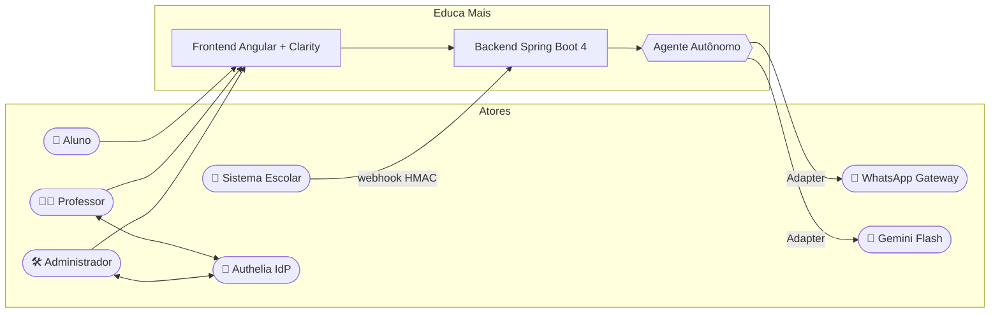
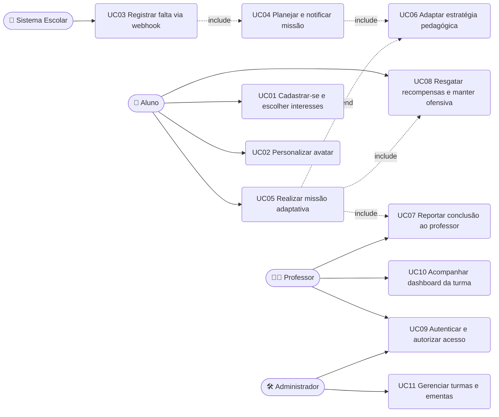

# 🎭 Especificação de Casos de Uso — Educa Mais

| Campo | Valor |
| --- | --- |
| Versão | 1.0.0 |
| Escopo | MVP — recuperação de aprendizagem mediada por agente autônomo |
| Base | [Requisitos](requisitos.md) · [User Stories](user-stories.md) |

---

## 1. Atores e Fronteira do Sistema

### 1.1 Descrição dos atores

| Ator | Tipo | Responsabilidades no sistema |
| --- | --- | --- |
| **Aluno** | Primário | Cadastra-se, escolhe interesses, personaliza avatar, executa missões, consome recompensas |
| **Agente Autônomo** | Sistema (IA) | Observa faltas, planeja trilha, notifica, ensina, avalia, adapta, recompensa e reporta |
| **Sistema Escolar** | Externo | Publica eventos de falta e ementas via API/webhook autenticado |
| **Professor** | Primário | Recebe relatórios, acompanha dashboard, valida diagnóstico |
| **Administrador** | Secundário | Gerencia turmas, aulas, vínculos e usuários |
| **Authelia (IdP)** | Externo | Autentica professores/admins via OIDC/SSO |
| **WhatsApp Gateway** | Externo | Entrega a mensagem proativa ao aluno |

---

## 2. Diagrama de Casos de Uso

---

## 3. Casos de Uso Detalhados

### UC01 — Cadastrar aluno e escolher interesses

| Campo | Descrição |
| --- | --- |
| **Atores** | Aluno |
| **Requisitos** | RF01, RF03, RF05, RNF06, RNF12 |
| **Pré-condições** | Aluno possui matrícula válida informada pela escola; e-mail não cadastrado |
| **Pós-condições** | Aluno persistido com PII cifrada, papel `ALUNO`, interesses gravados, JWT emitido |

**Fluxo principal**
1. Aluno informa nome, e-mail, data de nascimento, telefone e senha.
2. Sistema valida formato e força de senha (mín. 8 caracteres, 1 número, 1 símbolo).
3. Sistema cifra PII com AES-256-GCM e persiste o aluno (`status = PENDING_ONBOARDING`).
4. Sistema autentica e devolve `accessToken` + `refreshToken`.
5. Aluno seleciona de 1 a 5 interesses (futebol, games, música, ciência, moda, natureza…).
6. Sistema conclui o onboarding (`status = ACTIVE`) e exibe o construtor de avatar.

**Fluxos alternativos**
- **A1 — E-mail já cadastrado:** sistema retorna `409 CONFLICT` com orientação de recuperação de senha.
- **A2 — Nenhum interesse selecionado:** sistema usa `DEFAULT_INTEREST = "natureza"` e alerta o aluno.
- **A3 — Aluno menor de 18 anos:** sistema exige aceite de termo do responsável (checkbox auditado).

**Fluxos de exceção**
- **E1 — Payload inválido:** `400 Bad Request` com lista de campos violados (Bean Validation).
- **E2 — Falha na cifragem (chave ausente):** `500` com log de alerta de segurança; nada é persistido em claro.

---

### UC02 — Personalizar avatar

| Campo | Descrição |
| --- | --- |
| **Atores** | Aluno |
| **Requisitos** | RF04, RF31, RN01 |
| **Pré-condições** | Aluno autenticado com JWT válido |
| **Pós-condições** | Avatar atualizado; moedas debitadas; item marcado como possuído |

**Fluxo principal**
1. Aluno abre a loja e visualiza itens (preço em Moedas).
2. Aluno escolhe um item e confirma a compra.
3. Sistema valida saldo (`coins >= price`).
4. Sistema debita Moedas, registra `avatar_item_owned` e aplica o item ao avatar.
5. Sistema devolve o avatar atualizado.

**Fluxos alternativos**
- **A1 — Saldo insuficiente:** `422 UNPROCESSABLE_ENTITY` com `missingCoins` e sugestão de missão pendente.
- **A2 — Item já possuído:** sistema não debita novamente (idempotente) e apenas aplica.
- **A3 — Conversão de Diamante:** aluno converte 1 💎 em 10 Moedas antes de comprar.

**Fluxos de exceção**
- **E1 — JWT expirado:** `401 Unauthorized`; frontend redireciona para refresh/login.
- **E2 — Concorrência em compra dupla:** controle otimista (`@Version`) devolve `409` e o frontend recarrega o saldo.

---

### UC03 — Registrar falta via webhook do sistema escolar

| Campo | Descrição |
| --- | --- |
| **Atores** | Sistema Escolar (primário), Agente Autônomo (secundário) |
| **Requisitos** | RF06–RF11, RNF07, RNF08, RN06 |
| **Pré-condições** | Cliente do sistema escolar possui API Key ativa e *shared secret* HMAC |
| **Pós-condições** | Evento aceito (`202`), publicado na fila, falta registrada e missão enfileirada |

**Fluxo principal**
1. Sistema escolar envia `POST /api/v1/integrations/school/attendance` com headers `X-Api-Key`, `X-Signature`, `X-Timestamp` e corpo JSON.
2. Backend valida a API Key contra a lista de clientes ativos.
3. Backend recalcula o HMAC-SHA256 do corpo e compara em tempo constante.
4. Backend valida o timestamp (janela de 5 min) e a idempotência por `eventId`.
5. Backend responde `202 Accepted` e publica o evento (`AttendanceEventPublisher`).
6. Consumer registra a falta e aciona o agente (UC04).

**Fluxos alternativos**
- **A1 — `eventId` já processado:** resposta `200 OK` com `{"status":"IGNORED_DUPLICATE"}` — nenhuma nova missão.
- **A2 — Aluno não encontrado:** evento é persistido como `UNRECONCILED` para tratamento pelo admin; `422`.
- **A3 — Processamento assíncrono indisponível:** evento é gravado em *outbox* e reprocessado por *scheduler*.

**Fluxos de exceção**
- **E1 — Assinatura inválida:** `401 Unauthorized`, log de segurança `SECURITY_HMAC_MISMATCH`, *rate limit* reforçado no IP.
- **E2 — Replay (timestamp antigo):** `401` com `SECURITY_REPLAY_DETECTED`.
- **E3 — API Key desconhecida/revogada:** `401`, contador de tentativas para bloqueio.
- **E4 — Payload malformado:** `400`, evento descartado e reportado ao cliente.

---

### UC04 — Planejar e notificar missão (ciclo autônomo do agente)

| Campo | Descrição |
| --- | --- |
| **Atores** | Agente Autônomo (primário), Aluno (secundário) |
| **Requisitos** | RF12–RF15, RF20–RF26, RNF02, RNF03, RN06, RN09 |
| **Pré-condições** | Falta registrada; aluno ativo com interesses; ementa da aula disponível |
| **Pós-condições** | Missão em `NOTIFIED`, notificação in-app criada, tentativa de WhatsApp registrada, ciclo auditado |

**Fluxo principal**
1. Agente consulta aluno, interesses e ementa da aula (Tool Calling).
2. Agente monta o *prompt* com objetivo curricular + interesse principal do aluno.
3. Gemini Flash retorna plano em JSON validado por *Structured Output* (2–5 passos).
4. Validador de *grounding* descarta tópicos fora da ementa.
5. Agente persiste a missão (`status = PLANNED`) e os passos.
6. Agente registra a ação no *audit trail*.
7. Agente cria notificação in-app (UC04.1) e dispara WhatsApp (UC04.2).
8. Missão passa a `NOTIFIED`.

**Fluxos alternativos**
- **A1 — LLM fora do ar / timeout:** após 2 retries, `FallbackPlanner` gera plano determinístico a partir da ementa; missão segue com `planSource = FALLBACK`.
- **A2 — JSON inválido no *structured output*:** validação falha, 1 retentativa com *repair prompt*, depois fallback (A1).
- **A3 — Sem ementa cadastrada:** missão em `BLOCKED_NO_SYLLABUS`; admin é notificado.
- **A4 — Aluno sem *opt-in* de WhatsApp:** canal WhatsApp é `SKIPPED` (RN09), in-app permanece.

**Sub-fluxo UC04.1 — Notificação in-app**
1. Cria `notification` com `channel = IN_APP`, `status = PENDING`.
2. Publica no *event stream* para exibição em tempo real (polling no MVP).
3. Marca `SENT` ao ser entregue.

**Sub-fluxo UC04.2 — Disparo WhatsApp**
1. Roteador escolhe o provedor configurado (`TWILIO` ou `EVOLUTION`).
2. Envia mensagem com nome, conteúdo perdido, *deep link* e chamada para ação.
3. Registra `providerMessageId` e `status = SENT`.

**Fluxos de exceção**
- **E1 — Falha no disparo de WhatsApp (`4xx/5xx` ou timeout):** status `FAILED`, 2 retries com *backoff*, notificação in-app permanece como canal garantido, alerta métrico é incrementado e o fluxo **não é interrompido**.
- **E2 — Credencial do provedor ausente:** adapter entra em modo `DEMO` e registra `SKIPPED` com motivo `NO_CREDENTIALS`.
- **E3 — Aluno sem telefone:** WhatsApp `SKIPPED/NO_PHONE`, in-app segue.

---

### UC05 — Realizar missão adaptativa

| Campo | Descrição |
| --- | --- |
| **Atores** | Aluno (primário), Agente Autônomo (secundário) |
| **Requisitos** | RF16–RF19, RF27, RF28, RF29, RN02, RN05 |
| **Pré-condições** | Missão em `NOTIFIED` ou `IN_PROGRESS`; aluno autenticado e proprietário da missão |
| **Pós-condições** | Missão concluída, XP/Diamante concedidos, relatório disparado (UC07) |

**Fluxo principal**
1. Aluno abre a missão e lê a introdução contextualizada.
2. Agente apresenta a explicação do passo 1 com exemplo no interesse do aluno.
3. Agente apresenta exercício diagnóstico.
4. Aluno responde.
5. Agente avalia e dá feedback imediato.
6. **Se `CORRECT`:** agente avança (UC05.1). **Se `PARTIAL`/`INCORRECT`:** agente adapta (UC06).
7. Ao concluir todos os passos, agente aplica recompensas (UC08) e reporta ao professor (UC07).

**Fluxos alternativos**
- **A1 — Aluno abandona a missão:** missão permanece `IN_PROGRESS`; lembrete é reagendado 1× por dia (máx. 3).
- **A2 — Aluno já concluiu:** sistema retorna `200` com estado final (idempotente), sem nova recompensa (RN03).
- **A3 — Aluno pede nova abordagem:** pode solicitar "explicar de outro jeito" mesmo sem errar.

**Fluxos de exceção**
- **E1 — JWT inválido/expirado:** `401`; o frontend renova o token e reenvia a resposta.
- **E2 — Aluno tenta acessar missão de outro:** `403 Forbidden` + log de auditoria `ACCESS_DENIED_MISSION`.
- **E3 — Missão cancelada (falta justificada):** `409 CONFLICT` com motivo.

---

### UC06 — Adaptar estratégia pedagógica (fluxo alternativo do agente)

| Campo | Descrição |
| --- | --- |
| **Atores** | Agente Autônomo (primário), Aluno (secundário) |
| **Requisitos** | RF18, RF20, RN05, RN08 |
| **Pré-condições** | Resposta classificada como `INCORRECT` ou `PARTIAL` |
| **Pós-condições** | Nova explicação registrada com estratégia diferente; contador de tentativas incrementado |

**Fluxo principal**
1. Agente identifica a **lacuna específica** (ex.: confundiu proporção com razão).
2. `AdaptiveStrategySelector` escolhe a próxima estratégia não utilizada no passo.
3. Agente gera nova explicação mantendo o **mesmo objetivo curricular** (RN08).
4. Agente aplica novo exercício calibrado (dificuldade levemente menor).
5. Agente registra `adaptation_applied` no *audit trail*.

**Fluxos alternativos**
- **A1 — Terceira tentativa falha:** agente aplica estratégia `STEP_BY_STEP` com andaimes, marca o passo como `NEEDS_REINFORCEMENT`, **não bloqueia** a conclusão e sinaliza o professor no relatório.
- **A2 — Aluno acerta após adaptação:** passo é marcado `COMPLETED_WITH_SUPPORT` e o agent avança.

**Fluxos de exceção**
- **E1 — LLM não gera alternativa válida:** agente usa *template* determinístico da biblioteca pedagógica (`PedagogicalTemplates`) — nunca deixa o aluno sem resposta.
- **E2 — Loop detectado (> 3 adaptações no mesmo passo):** agente encerra o passo com reforço e escala ao professor.

---

### UC07 — Reportar conclusão ao professor

| Campo | Descrição |
| --- | --- |
| **Atores** | Agente Autônomo (primário), Professor (secundário) |
| **Requisitos** | RF22, RF33, RF34, RNF28, RN07 |
| **Pré-condições** | Missão concluída (`COMPLETED` ou `COMPLETED_WITH_SUPPORT`) |
| **Pós-condições** | Relatório persistido e visível ao professor; evento `report.delivered` registrado |

**Fluxo principal**
1. Agente compila: conteúdo perdido, passos, acertos, tentativas, lacunas, tempo e recompensa.
2. Agente gera recomendação pedagógica (Gemini Flash, *structured output*; fallback por regra).
3. Agente persiste o relatório vinculado a aluno/aula/turma.
4. Agente notifica o professor (in-app) e disponibiliza no dashboard.
5. Se configurado canal e-mail/Slack, encaminha; senão apenas in-app.

**Fluxos alternativos**
- **A1 — Professor sem conta ativa:** relatório fica pendente e aparece ao admin; alerta é criado.
- **A2 — Reenvio manual:** professor pode solicitar reenvio do relatório.

**Fluxos de exceção**
- **E1 — Falha na geração da recomendação:** relatório é entregue com recomendação padrão baseada em regras.
- **E2 — Erro de persistência:** *outbox* retém o evento e reprocessa; agente registra `REPORT_RETRY`.

---

### UC08 — Resgatar recompensas e manter ofensiva

| Campo | Descrição |
| --- | --- |
| **Atores** | Aluno, Agente Autônomo |
| **Requisitos** | RF29, RF30, RF31, RF32, RN01, RN03, RN04 |
| **Pré-condições** | Missão concluída e não recompensada |
| **Pós-condições** | `+50 XP`, `+1 Diamante`, ofensiva atualizada, nível recalculado |

**Fluxo principal**
1. Agente verifica idempotência por `missionId` (RN03).
2. Soma +50 XP, +1 Diamante ao `gamification_profile`.
3. Recalcula nível (`100 × nível`).
4. Incrementa ofensiva se o dia letivo foi cumprido (RN04).
5. Publica `rewards.granted` e devolve o resumo ao aluno (animação no frontend).

**Fluxos alternativos**
- **A1 — Recompensa já concedida:** retorna estado atual sem duplicar (idempotente).
- **A2 — Ofensiva zerada por falta não recuperada:** exibe mensagem motivacional e a nova sequência.

**Fluxos de exceção**
- **E1 — Falha transacional:** rollback completo; nenhum XP parcial é gravado.

---

### UC09 — Autenticar e autorizar acesso (JWT + Authelia)

| Campo | Descrição |
| --- | --- |
| **Atores** | Todos os humanos, Authelia (IdP) |
| **Requisitos** | RF02, RF36, RNF06–RNF11, RNF14, RNF16 |
| **Pré-condições** | Usuário existente e ativo |

**Fluxo principal (aluno)**
1. Aluno envia credenciais a `POST /api/v1/auth/login`.
2. Backend valida BCrypt e emite JWT HS256 (`sub`, `roles`, `schoolId`, `exp`).
3. Cliente envia `Authorization: Bearer <token>`.
4. `JwtAuthenticationFilter` valida assinatura, expiração, emissor e audiência; popula o `SecurityContext`.
5. `AccessPolicy` autoriza a operação conforme papel e vínculo.

**Fluxo principal (professor/admin — SSO)**
1. Usuário é redirecionado ao **Authelia** (OIDC Authorization Code + PKCE).
2. Authelia autentica (LDAP/arquivo de usuários) e devolve `code`.
3. Backend troca o `code` por `id_token`, valida assinatura/`nonce` e mapeia `groups` → `ROLE_PROFESSOR`/`ROLE_ADMIN`.
4. Backend emite o JWT interno e a sessão segue *stateless*.

**Fluxos de exceção**
- **E1 — Token JWT inválido (assinatura/issuer/audience):** `401` com `WWW-Authenticate: Bearer error="invalid_token"`.
- **E2 — Token expirado:** `401` + código `TOKEN_EXPIRED`; o frontend usa o refresh token.
- **E3 — Papel insuficiente:** `403` + `ACCESS_DENIED_ROLE`.
- **E4 — Origem CORS não autorizada:** requisição bloqueada, `403`, log `CORS_REJECTED`.
- **E5 — Brute force (> 10 tentativas/min):** `429 Too Many Requests` + bloqueio temporário.
- **E6 — Authelia indisponível:** login SSO falha com mensagem clara; login local de aluno não é afetado.

---

### UC10 — Acompanhar dashboard da turma (Professor)

| Campo | Descrição |
| --- | --- |
| **Atores** | Professor |
| **Requisitos** | RF34, RF33, RNF16, RN07 |
| **Pré-condições** | Professor autenticado e vinculado à turma |

**Fluxo principal**
1. Professor acessa `/professor/dashboard`.
2. Sistema lista turmas do professor.
3. Professor seleciona a turma e visualiza: alunos em risco, missões pendentes, taxa de conclusão, média de acerto.
4. Professor abre o relatório de um aluno e registra um comentário opcional.

**Fluxos alternativos**
- **A1 — Turma sem missões:** estado vazio orientativo (RNF21).
- **A2 — Filtro por período:** dados agregados por semana/mês.

**Fluxos de exceção**
- **E1 — Professor tenta acessar turma alheia:** `403 ACCESS_DENIED_SCHOOL`.
- **E2 — Sessão expirada:** `401` e redirecionamento ao Authelia.

---

### UC11 — Gerenciar turmas e ementas (Administrador)

| Campo | Descrição |
| --- | --- |
| **Atores** | Administrador |
| **Requisitos** | RF35, RF11, RF38 |
| **Fluxo principal**
1. Admin cria turma, vincula professor e importa alunos.
2. Admin cadastra aula com ementa (objetivos, tópicos, pré-requisitos).
3. Admin revisa eventos `UNRECONCILED` e justifica faltas.
4. Admin atende solicitação de anonimização (RF38) com trilha de auditoria.

**Fluxos de exceção**
- **E1 — Ementa sem objetivos:** `422` — o agente não pode planejar sem objetivos de aprendizagem.
- **E2 — Exclusão de aluno com missão ativa:** exige confirmação e anonimiza em vez de excluir fisicamente.

---

## 4. Matriz Caso de Uso × Requisito

| UC | RF | RNF |
| --- | --- | --- |
| UC01 | RF01, RF03, RF05 | RNF06, RNF10, RNF12 |
| UC02 | RF04, RF31 | RNF06, RNF08 |
| UC03 | RF06–RF11 | RNF01, RNF07, RNF08, RNF14 |
| UC04 | RF12–RF15, RF20–RF26 | RNF02, RNF03, RNF09 |
| UC05 | RF16–RF19, RF27–RF29 | RNF04, RNF17, RNF21 |
| UC06 | RF18, RF20 | RNF03 |
| UC07 | RF22, RF33, RF34 | RNF04, RNF16 |
| UC08 | RF29–RF32 | RNF10 |
| UC09 | RF02, RF36 | RNF06–RNF16 |
| UC10 | RF33, RF34 | RNF16, RNF21 |
| UC11 | RF11, RF35, RF38 | RNF16, RNF32 |

---

🔗 [Requisitos](requisitos.md) · [User Stories](user-stories.md) · [Arquitetura](arquitetura-agente.md)
