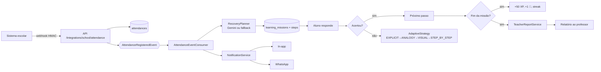

# 🗺️ Diagramas — Educa Mais

Todos os diagramas do projeto usam **Mermaid** dentro de Markdown (renderizam direto no GitHub,
sem dependência de PlantUML ou ferramentas externas). Este índice reúne os diagramas por visão
arquitetural, com o link para o documento onde cada um aparece.

## Índice por visão

| Visão (C4) | Diagrama | Arquivo |
| --- | --- | --- |
| Contexto (C1) | Atores, sistemas externos e fronteiras | [arquitetura-agente.md §2](../arquitetura-agente.md#2-c4--nível-1-contexto-do-sistema) |
| Container (C2) | API, Web, RDS, filas, IdP | [arquitetura-agente.md §3](../arquitetura-agente.md#3-c4--nível-2-contêineres) |
| Componente (C3) | Camadas domain/service/agent/infrastructure | [arquitetura-agente.md §4](../arquitetura-agente.md#4-c4--nível-3-componentes-do-backend) |
| Classes | Entidades ricas e ports | [arquitetura-agente.md §4.1](../arquitetura-agente.md#41-mapa-de-pacotes-implementado) |
| Dados (DER) | 17 tabelas, PII cifrada, índices cegos | [arquitetura-agente.md §8](../arquitetura-agente.md#8-modelo-entidade-relacionamento-der) |
| Fluxo do agente | Sequência webhook → missão → recompensa | [arquitetura-agente.md §5](../arquitetura-agente.md#5-fluxo-autônomo-do-agente-ponta-a-ponta) |
| AWS | App Runner, RDS, SQS/EventBridge, Secrets Manager | [arquitetura-agente.md §6](../arquitetura-agente.md#6-arquitetura-aws-produção) |
| Autenticação | JWT stateless + OIDC/Authelia + HMAC | [arquitetura-agente.md §7](../arquitetura-agente.md#7-segurança-authelia-oidc--jwt--hmac) |
| Estados da missão | State machine PLANNED → COMPLETED | [arquitetura-agente.md §5.1](../arquitetura-agente.md#51-máquina-de-estados-da-missão) |
| Casos de uso | 11 casos de uso e atores | [casos-de-uso.md §2](../casos-de-uso.md#2-diagrama-de-casos-de-uso) |

## Convenções

- **Nomenclatura**: `C1`–`C4` seguem o modelo [C4](https://c4model.com/); DER segue notação
  *crow's foot* em texto (cardinalidade descrita na legenda de cada relacionamento).
- **Fonte da verdade**: os diagramas são versionados junto ao código e evoluem por PR; qualquer
  mudança de contrato (API, tabela, fila) exige atualização no mesmo PR.
- **Rastreabilidade**: cada diagrama cita os requisitos (`RF##`/`RNF##`) que ilustra, permitindo
  navegar do requisito para a arquitetura.

## Diagrama rápido: ciclo autônomo

